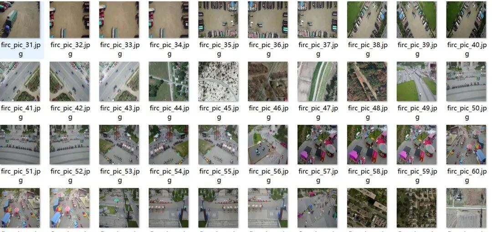
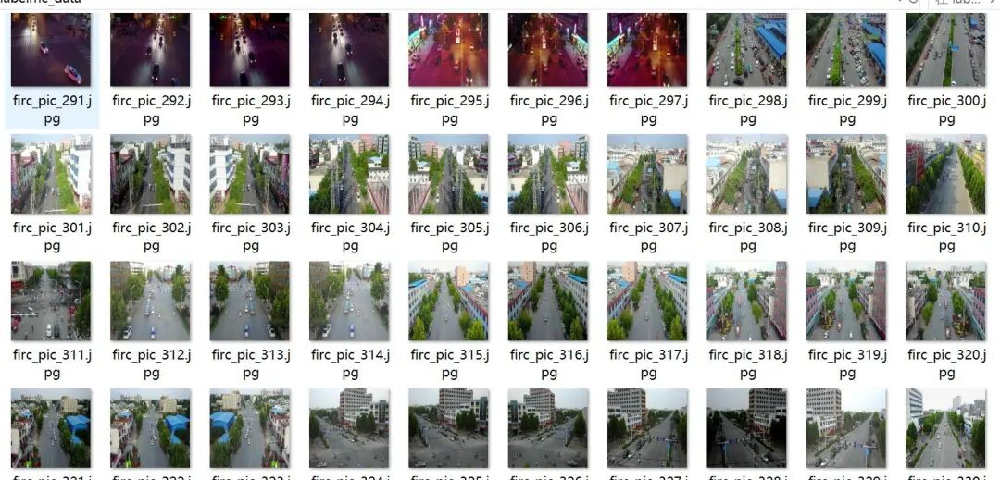
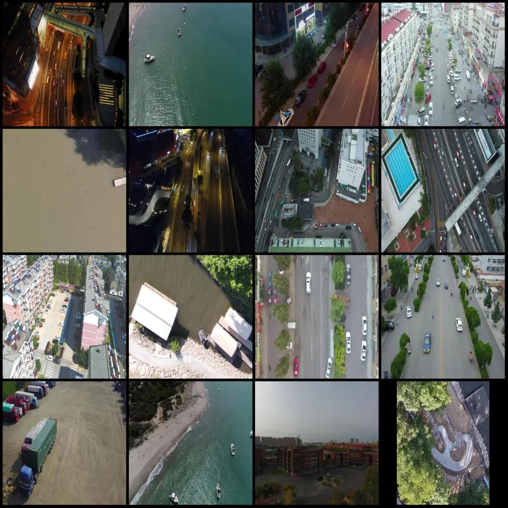
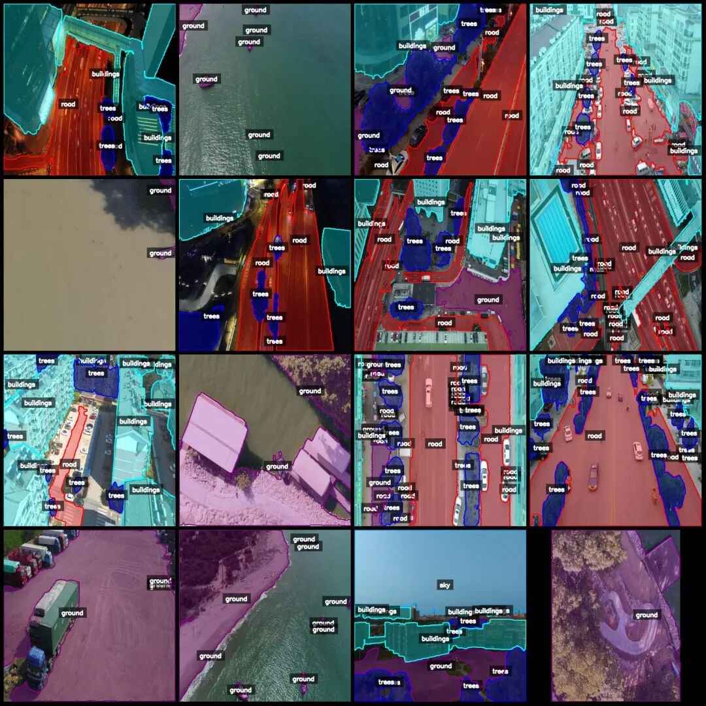
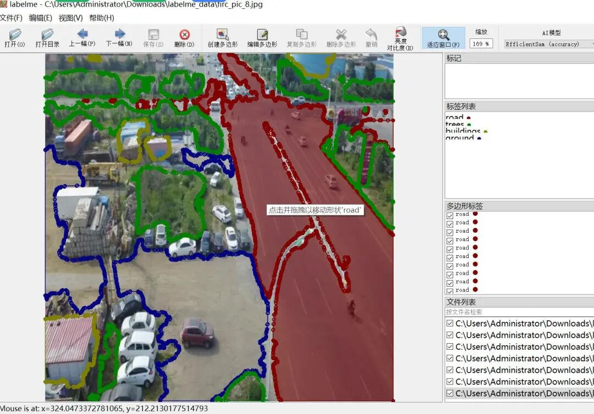

# Drone Perspective Road Trees Ground Building Water Body Sky Grass Segmentation Dataset - LabelMe format - 4806 images, 7 categories

Dataset format: labelme format (without mask files, only including jpg images and corresponding json files)

Number of images (number of jpg files): 4802

Number of annotations (json file count): 4802

Label category count: 7

Annotation category names: ["road", "trees", "ground", "buildings", "water", "sky", "grass"]

Number of boxes labeled in each category:

Count = 22269

Trees (Trees) count = 19444

Count = 8154

Buildings (Structures) count = 12447

Water (aquatic) count = 804

Count = 543

Grass (grass) count = 615

Total frame count: 64276

Using labeling tool: labelme=5.5.0

Image resolution: 512x512

Drone: DJI MAVIC 3

Collection height: 50m

Sampling angle: 60°

Annotation rules: Draw polygons around the categories.

Important Notice: The dataset can be opened and edited using LabelMe. For JSON datasets, one must convert them into mask or Yolo formats for semantic segmentation or instance segmentation.

Special : This dataset does not guarantee the accuracy of the trained models or weight files.

Image Preview:

Annotation example:

Original image (randomly select 16 images):

Annotation:

LabelMe editing example:

## Payment

Here is a pay link on Stripe ( https://buy.stripe.com/3cs8yP7sY87d0vu9AB ). Please contact me lonlonago@foxmail.com after funding $89, and I will send you a complete data files , thank you!

